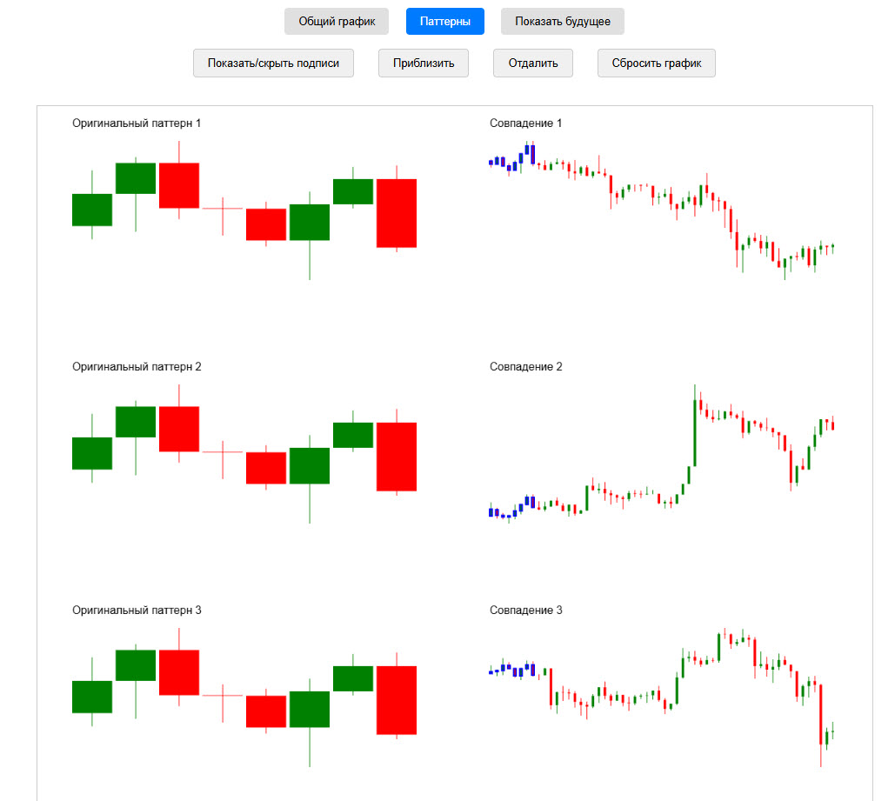
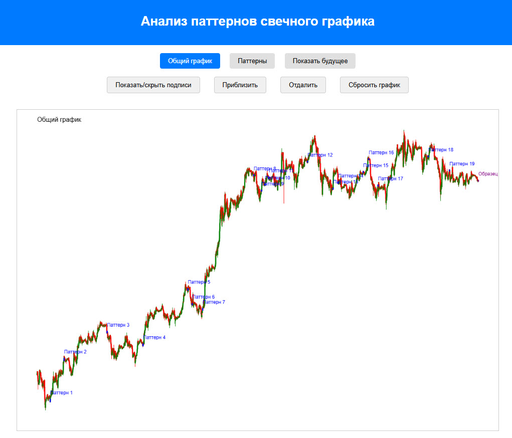
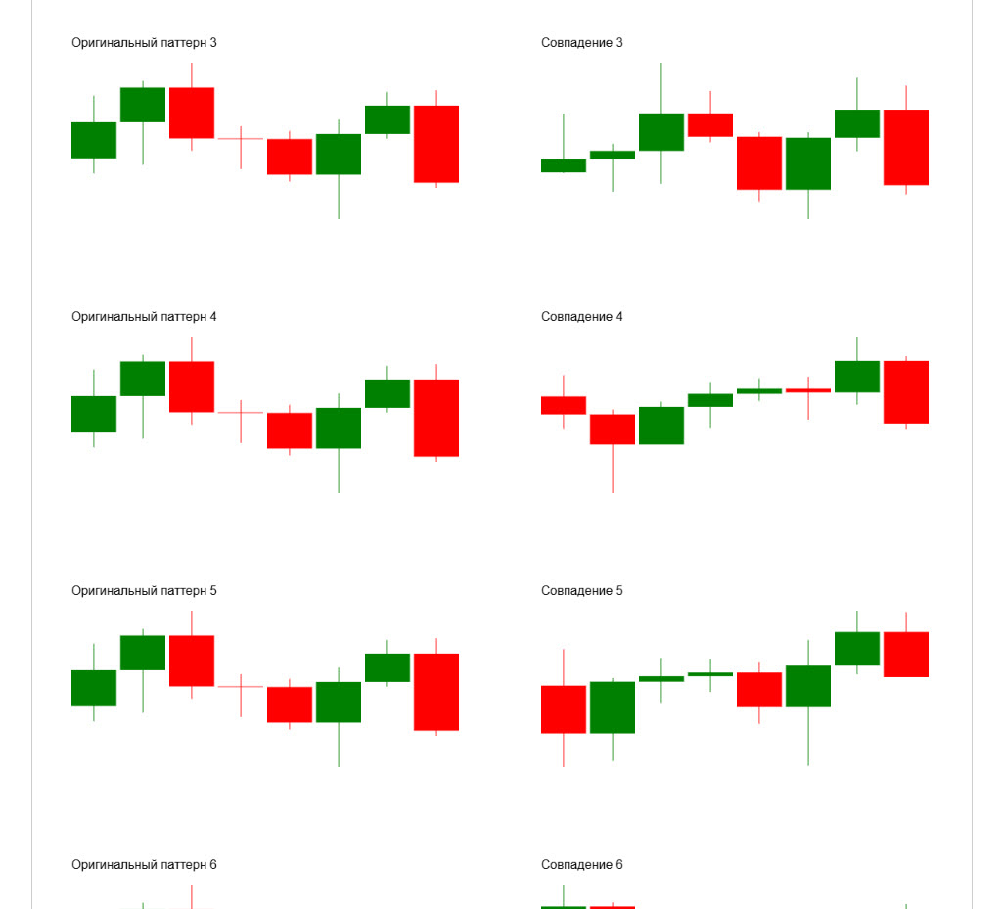
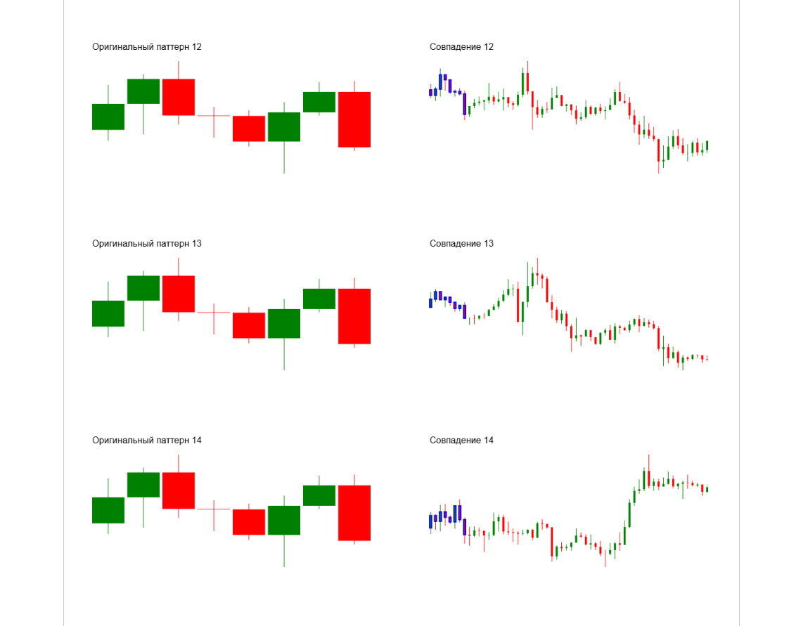
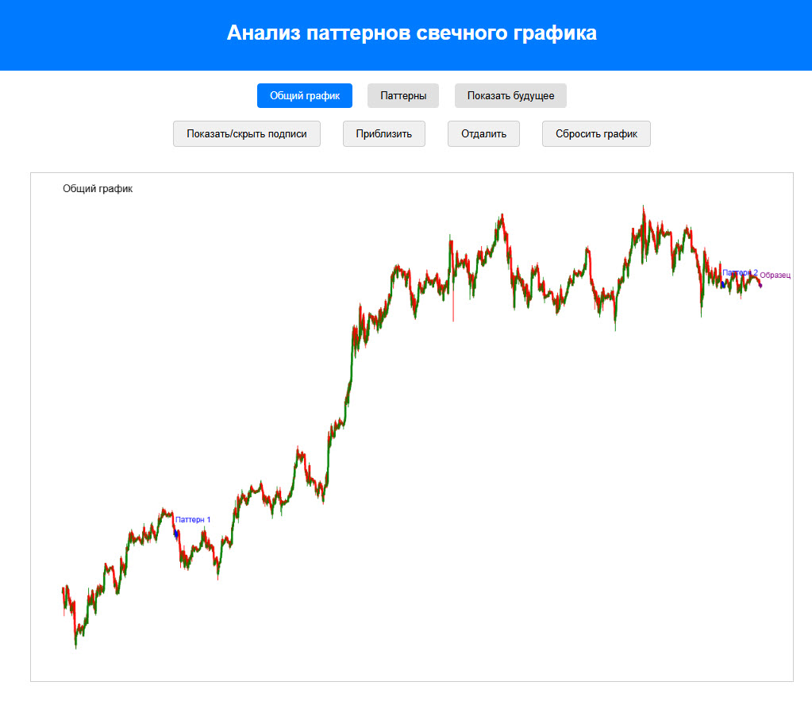
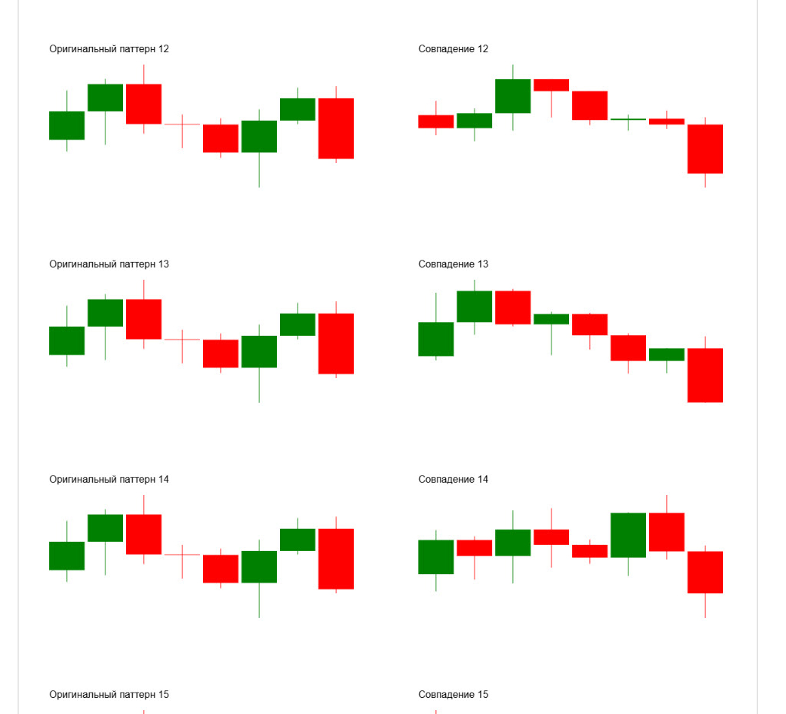

# Поиск похожих участков графика

Рабочее название: `pattern_search`.

Исследовательский инструмент для поиска похожих участков в истории криптовалют. Python сравнивает последний фрагмент ряда с предыдущими окнами и сохраняет результаты в JSON. Отдельная HTML-страница показывает исходный график, образец и найденные совпадения.

**Python-портфолио Евгения Толмачева** · Python · NumPy · pandas · PyWavelets · JavaScript · Canvas



## Скриншоты

<details>
<summary>Поиск похожих участков графика - 6 снимков</summary>

### Скриншот 1


### Скриншот 2



### Скриншот 3



### Скриншот 4



### Скриншот 5



### Скриншот 6



</details>

## Возможности

- Формирует признаки свечей из тела, верхней и нижней тени, а также изменений цены.
- Сравнивает фрагменты по MSE, корреляции, форме, DTW, вейвлетам и многомасштабной корреляции.
- Позволяет задать длину образца, порог сходства и линейную или логарифмическую шкалу в Python-скрипте.
- В браузере показывает совпадения, масштабирование и последующие свечи для визуальной проверки результатов.

## Как устроен проект

### Сравнение фрагментов

[`pattern_search.py`](pattern_search.py)

Реализует методы сходства, проходит по истории скользящим окном и записывает candlestick_patterns.json.

### Подготовка истории

[`scripts/get_data_coin_bybit.py`](scripts/get_data_coin_bybit.py), [`scripts/get_data_btc_binance_1d.py`](scripts/get_data_btc_binance_1d.py)

Загружает свечи из биржевых API для последующей обработки.

### Отрисовка

[`static/draw_main_chart.js`](static/draw_main_chart.js), [`static/draw_patterns_chart.js`](static/draw_patterns_chart.js)

Рисует основной график и отдельные найденные фрагменты на Canvas.

### Управление просмотром

[`static/main_logic.js`](static/main_logic.js), [`index.html`](index.html)

Связывает вкладки, масштабирование, перемещение и переключение последующих свечей.

## Технологии и их роль

- **pandas и NumPy**: Подготовка рядов и численные операции над окнами данных.
- **PyWavelets и собственные функции сравнения**: Вейвлет-преобразование, DTW, корреляция и сравнение формы свечей.
- **JavaScript и Canvas**: Просмотр результатов и взаимодействие с графиками.
- **JSON**: Передача рассчитанных данных из Python в браузер.

## С чего начать просмотр кода


Алгоритмы сосредоточены в pattern_search.py. Файлы static показывают, как результат вычислений превращается в интерактивный инструмент сравнения.

## Подготовка и запуск

Создайте отдельное окружение и установите исходные зависимости:

```powershell
python -m venv .venv
.venv\Scripts\Activate.ps1
python -m pip install -r requirements.txt
```

Подготовьте dataframe/dataframe_bybit_btc_1h.pkl. После расчётов интерфейс index.html можно открыть через локальный HTTP-сервер: python -m http.server 8000. Архивы котировок и сгенерированные результаты не включены.

Переменные окружения: `BINANCE_API_KEY`, `BINANCE_API_SECRET`. Образец находится в [.env.example](.env.example). Сам файл .env автоматически не загружается: исходники читают окружение процесса. Значения нужно передать перед запуском, например в PowerShell:

```powershell
$env:BINANCE_API_KEY = "YOUR_VALUE"
```

После подготовки настроек и необходимых данных основная точка входа:

```powershell
python pattern_search.py
```

`requirements.txt` сохранён из проекта. Это снимок окружения, а не гарантия совместимости с новейшей версией Python. Для старых проектов могут потребоваться соответствующая версия Python и настройка системных компонентов.

## Структура

```text
pattern_search/
├── docs/
│   ├── preview.webp
│   └── screenshots/  # скриншоты из портфолио
├── scripts/
│   ├── get_all_coin_bybit.py
│   ├── get_data_btc_binance_1d.py
│   └── get_data_coin_bybit.py
├── static/
│   ├── draw_main_chart.js
│   ├── draw_patterns_chart.js
│   ├── main_logic.js
│   └── style.css
├── .env.example
├── .gitignore
├── index.html
├── pattern_search.py
├── README.md
└── requirements.txt
```

## Контекст и ограничения

Работа объединяет подготовку биржевых данных и эксперименты с методами сравнения временных рядов. Расчёт и визуализация связаны файлом JSON: браузер отображает подготовленный результат. Найденное сходство является исследовательским признаком, а не готовой моделью прогноза.

Проверены синтаксис Python-файлов и состав публикации. Полный запуск этой версии с внешними сервисами, локальными данными или моделями не выполнялся; команды выше описывают подготовку по исходникам.

## Состав репозитория

Сохранены авторские исходники, их имена и структура, зависимости и скриншоты интерфейса. Рабочие базы, наборы данных, модели и виртуальные окружения исключены. Секреты заменены обозначениями `YOUR_...` / `REDACTED_...`; реальные значения задаются локально. Исходные алгоритмы при оформлении портфолио не перерабатывались.

Автор: [Евгений Толмачев](https://github.com/EvgenyET) · [Портфолио](https://evgeny.tech/)
