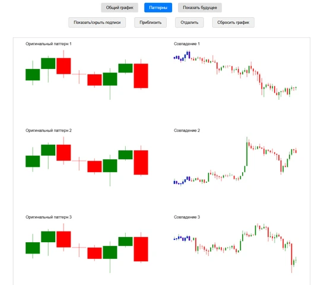

# pattern_search

Поиск похожих участков истории криптовалют: сравнение последовательностей свечей и визуализация совпадений.

**Python-портфолио Евгения Толмачева** · Начало: 2023 · Python · JavaScript · pandas · PyWavelets · DTW



## Возможности

- Подготовка и выбор фрагмента исторических данных.
- Сравнение последовательностей несколькими методами.
- Отображение найденных совпадений на графиках.

## Что смотреть в коде

Сравнение свечных последовательностей: MSE, корреляция, DTW, форма и вейвлет-представление; отдельный интерфейс результатов.

Начните с `pattern_search.py`. Названия авторских файлов и их расположение сохранены.

## Структура

```text
pattern_search/
├── docs/
│   └── preview.webp
├── scripts/
│   ├── get_all_coin_bybit.py
│   ├── get_data_btc_binance_1d.py
│   └── get_data_coin_bybit.py
├── static/
│   ├── draw_main_chart.js
│   ├── draw_patterns_chart.js
│   ├── main_logic.js
│   └── style.css
├── .env.example
├── .gitignore
├── index.html
├── pattern_search.py
├── README.md
├── README.public.md
└── requirements.txt
```

## Подготовка и запуск

Это сохранённая версия пет-проекта, показывающая этап развития навыков. Для воспроизведения создайте отдельное окружение Python, совместимое с зафиксированными зависимостями:

```powershell
python -m venv .venv
.venv\Scripts\Activate.ps1
python -m pip install -r requirements.txt
```

Подготовьте dataframe/dataframe_bybit_btc_1h.pkl. После расчётов интерфейс index.html можно открыть через локальный HTTP-сервер: python -m http.server 8000. Архивы котировок и сгенерированные результаты не включены.

Переменные окружения: `BINANCE_API_KEY`, `BINANCE_API_SECRET`. Образец находится в [.env.example](.env.example). Сам файл .env автоматически не загружается: исходники читают окружение процесса. Значения нужно передать перед запуском, например в PowerShell:

```powershell
$env:BINANCE_API_KEY = "YOUR_VALUE"
```

После подготовки настроек и необходимых данных основная точка входа:

```powershell
python pattern_search.py
```

`requirements.txt` сохранён из проекта. Это снимок окружения, а не гарантия совместимости с новейшей версией Python. Для старых проектов могут потребоваться соответствующая версия Python и настройка системных компонентов.

## История и состав публикации

Старый загрузчик - декабрь 2023; CSS - январь 2025; основной код версии - февраль 2025.

В репозитории оставлены авторские исходники, зависимости и один компактный скриншот. Виртуальные окружения, сторонние библиотеки, рабочие базы, модели, большие наборы данных и персональные настройки не включены.

Чувствительные значения заменены понятными заглушками `YOUR_...` / `REDACTED_...`. Настоящие доступы не следует добавлять в Git. Алгоритмы и структура проекта при подготовке публикации не перерабатывались.

Проверена синтаксическая корректность Python-файлов и выполнено сканирование публикуемой копии на секреты. Полный запуск с внешними API, платежами, биржевыми операциями и локальными моделями не выполнялся.

Автор: [Евгений Толмачев](https://github.com/EvgenyET) · [Портфолио](https://evgeny.tech/)
